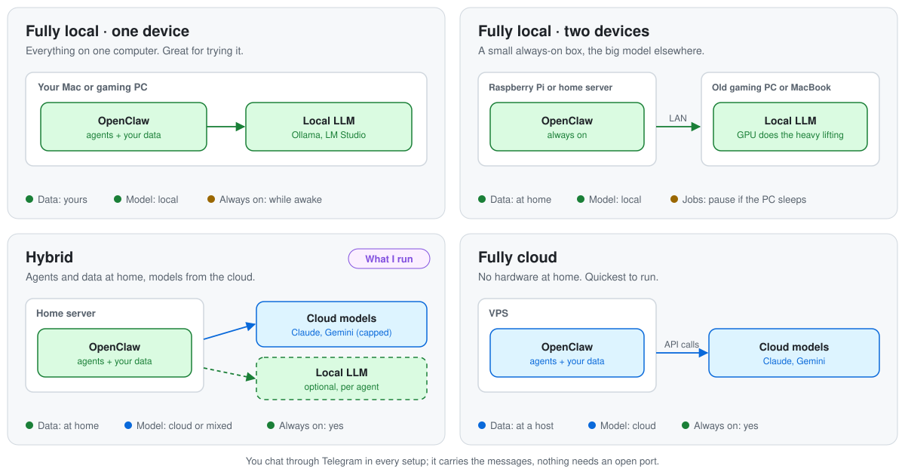

<div align="center">

<a href="https://cdn.jsdelivr.net/gh/jasonkochai/juniper@b8fdae5562a9fc33f20490d54ebdeba16be00624/assets/juniper-video.mp4"></a>
<sub>▶ Click for the full video with sound. Chat messages are illustrative.</sub>

# ⚡ Juniper

**A private, self-hosted alternative to Claude Duet, OpenAI's dots and xAI's Grok Bot.**<br>
Always-on AI agents for your mail, calendar and the tools you pick, in one chat,<br>
on a machine you control, fully local with your own LLM if you want.<br>
Built on OpenClaw. Nothing happens without your "yes".

[Quick start](#-quick-start) · [How it works](#-how-it-works) · [Ways to run it](#-ways-to-run-it) · [My setup](#-my-setup) · [Security](#-security)

</div>

**What I learned:** Docker and container hardening · Linux users and permissions · network security and least privilege · multi-agent system design · LLM tool permissions and prompt-injection defence · MCP integrations · local LLMs · secrets management · LLM cost and token optimisation

**Result:** token-efficient by design. By my estimate, the same agents cost about **$3 a month** in model fees instead of about **$120** with every agent on Claude Sonnet and no prompt caching: **roughly 97% less** ([how it's estimated](#-what-it-costs)).

<picture>
  <source media="(prefers-color-scheme: dark)" srcset="assets/juniper-dark.svg">
  
</picture>
<p align="center"><sub>My setup. Yours can use a different chat app, agents and tools.</sub></p>

## 🚀 Quick start

Open [Claude Code](https://claude.com/claude-code) in any folder and paste this:

```text
Clone https://github.com/jasonkochai/juniper and set up Juniper for me.
Read its CLAUDE.md first and follow it: help me choose where it runs,
which models, and which chat app, agents and tools I want, then set
up exactly that, phase by phase. Do every step you can yourself, tell
me exactly what I need to do, and never ask me for a password, key or
token.
```

Claude Code downloads the repo, asks what you want and builds that with you. It doesn't copy my setup: you pick the chat app (Telegram, WhatsApp, Signal, Discord, Slack …), the agents, your mail and calendar provider, the search engine and any extra tools, and it installs and configures only those. My choices are offered as the tested default. Read on if you want to know what it will do first.

## Contents

- [Why I built it](#-why-i-built-it)
- [How it works](#-how-it-works)
- [Ways to run it](#-ways-to-run-it)
- [Connect more tools](#-connect-more-tools)
- [What it costs](#-what-it-costs)
- [My setup](#-my-setup)
- [What you need](#-what-you-need)
- [What happens when you run it](#-what-happens-when-you-run-it)
- [Security](#-security)
- [Set it up by hand](#-set-it-up-by-hand)
- [Repo layout](#-repo-layout)
- [FAQ](#-faq)
- [Credits and license](#-credits-and-license)

## 💡 Why I built it

Always-on AI agents are arriving everywhere: Anthropic's Claude Duet, OpenAI's dots, xAI's Grok Bot. They work in the background, send you a morning overview and check in when something needs you. They also run on someone else's servers, with your mail, calendar and notes.

I wanted the same kind of assistant, **fully private**. So I built Juniper on [OpenClaw](https://docs.openclaw.ai):

- **Same idea.** Agents that work on their own schedule, brief you every morning, sort your inbox, find events and ask before they act.
- **Your machine.** It runs on your home server, a Raspberry Pi or your own computer, so your data stays on your devices. A VPS works too, if you accept a hosting provider.
- **Fully local if you want.** Swap the cloud models for your own LLM and no prompt, email or note ever reaches a model provider.
- **You decide what each agent may touch.** Every permission is a line in a config file you can read.

It's also a showcase of what OpenClaw can do: several agents with their own jobs, tools and permissions behind one chat. My agents and tools are one example; you pick your own, and OpenClaw [connects to much more](#-connect-more-tools). The big products are easier to start with; Juniper is for when privacy matters more than convenience.

## 🧩 How it works

The same whatever tools you pick:

- **One container, many agents.** OpenClaw runs in Docker on a machine you control. Each agent has one job and its own instructions, memory, model and tool list.
- **One chat, only you.** All agents sit behind one chat app, each in its own topic or channel where the app has them. The bot answers only your account, and every reply starts with the agent's emoji.
- **Narrow connectors.** Mail, calendar and extras connect through pinned MCP servers or plugins, filtered so only the tools an agent needs exist. Each connector belongs to one agent; the others are denied it.
- **On a schedule.** Agents run their own jobs (morning overview, inbox summary) and post the result in their topic.
- **Models per agent.** Cloud, local or mixed. My default: Claude Haiku where judgement matters, Gemini Flash-Lite (free tier) for bulk reading, each falling back to the other.
- **Rules live in this repo.** Agents can't change their own instructions. Details: [Security](#-security).

## 🧭 Ways to run it

Where OpenClaw runs and where the model runs are two separate choices. Mix them how you like:

<picture>
  <source media="(prefers-color-scheme: dark)" srcset="assets/setups-dark.svg">
  
</picture>

| Setup | OpenClaw runs on | The model runs on | Good for |
| --- | --- | --- | --- |
| **Fully local · one device** | your Mac or gaming PC (Docker Desktop) | the same machine (Ollama, LM Studio) | trying it, maximum privacy |
| **Fully local · two devices** | a Raspberry Pi or home server, always on | an old gaming PC or MacBook in your home network | private and always on, without a GPU in the small box |
| **Hybrid** · what I run | a home server or Raspberry Pi | cloud APIs (Claude, Gemini), optionally a local model for chosen agents | the best answers for the money, data stored at home |
| **Fully cloud** | a VPS | cloud APIs | no hardware at home |

I started fully local and now run the hybrid setup on my UGREEN home server. OpenClaw needs anything 64-bit with Docker and 4 GB of RAM; a local model needs a GPU or Apple Silicon. Details: [docs/hosts.md](docs/hosts.md).

**Fully local** means no prompt, email or note reaches a model provider. Use a model with good tool calling and about 32K of context; it will be slower and less careful than Haiku. Models are set per agent, so you can keep Email local and let News use the cloud. The chat app, your mail provider and the web lookups of Events and News are still outside services, and voice memos and image generation are off. How: [docs/local-llm.md](docs/local-llm.md).

## 🔌 Connect more tools

My setup uses Telegram, iCloud Mail and Calendar, Brave and Obsidian. During setup you can pick any of these instead, or add them:

| | |
| --- | --- |
| 💬 **Chat apps** | WhatsApp, Signal, Discord, Slack, iMessage, Matrix, Microsoft Teams, Google Chat, SMS, voice calls |
| 🧠 **Models** | Anthropic, OpenAI, Google, xAI, Mistral, DeepSeek, Groq, OpenRouter, Bedrock; locally Ollama, LM Studio, llama.cpp, vLLM, Apple on-device |
| 🔎 **Web search** | Brave, Tavily, Exa, Perplexity, Firecrawl, DuckDuckGo, self-hosted SearXNG |
| 🎨 **Media** | image and video generation (incl. local ComfyUI), speech from ElevenLabs, Deepgram, Azure |
| 📱 **Devices** | iOS and Android nodes with camera, location and voice; macOS, Windows and Linux companions |
| 🧩 **Anything with an MCP server** | Home Assistant, Notion, GitHub, Todoist, your own scripts, or hundreds of SaaS apps through Composio |

Each new tool goes to a single agent with a narrow tool list, the same way mail and calendar do in my setup. How: [docs/integrations.md](docs/integrations.md).

## 💶 What it costs

With my default models and search; other providers cost what they charge.

| | Typical | Hard cap |
| --- | --- | --- |
| Anthropic (Haiku) | a few dollars a month | $10 a month, set in the console |
| Google (Gemini Flash-Lite) | free tier | $8 if you enable billing for images |
| Brave Search | free credit | the free credit |
| Images | about $0.07 each, only when you ask | — |
| Voice memos | free tier, or about $0.001 a minute when billed | — |
| Fully local | $0 in API fees | — |

**How it stays cheap:**

- **The cheapest model that does the job.** Haiku costs a twentieth of Sonnet per token; the reading-heavy agents run on Gemini Flash-Lite's free tier.
- **Prompt caching.** Repeated instructions are read from the cache at a tenth of the price.
- **Small, fresh runs.** Scheduled jobs start with an empty session, the calendar overview loads a slim context, and the always-on heartbeat is off.
- **Capped inputs.** At most 30 mails per summary, 10,000 characters per web page and 12 fetches per news run, which also keeps Haiku under its 100K-token price jump.

The comparison is an estimate from my workload model: about $2.70 a month for Juniper's setup, about $118 for the same work on Sonnet without caching.

<details>
<summary>The workload behind the estimate</summary>

| Agent | Model | Runs a day | Input tokens per call | Output tokens per call |
| --- | --- | --- | --- | --- |
| Juniper (main) | Haiku | 15 | 12,000 | 600 |
| Calendar | Haiku | 4 | 7,000 | 250 |
| Events | Flash-Lite (free tier) | 3 | 25,000 | 900 |
| Email | Haiku | 4 | 18,000 | 1,000 |
| News | Flash-Lite (free tier) | 1 | 45,000 | 2,000 |

Each run makes 4 model calls, and half the input is read from the cache. Prices per million tokens: Haiku $0.10 in, $0.50 out, $0.01 cached; Sonnet $2, $10, $0.10. The Sonnet comparison runs every agent on Sonnet with no caching. Images, voice and search aren't included.

</details>

Fully local costs electricity instead of API fees. The hardware is whatever you already have, a Raspberry Pi, or a small VPS. Outside the EEA, Google may use free-tier prompts to improve its products; enable billing, or keep sensitive agents on Haiku or a local model.

## 🏠 My setup

This is what runs on my UGREEN home server. It's one example, and the tested default the setup offers; you pick your own chat app, agents and tools.

One Telegram bot, one private group, one topic per agent. I talk to the main assistant in a direct message or the group's General topic; the others post in their own topics. Mail and calendar are iCloud, web search is Brave, notes are one folder of my Obsidian vault.

| | Agent | What it does | What it can't do | Status |
| --- | --- | --- | --- | --- |
| ⚡ | **Juniper** (main) | chats, reads photos, passes events to Calendar; voice memos and images 🧪 | run commands, browse, read your mail or calendar | ✅ running |
| 📅 | **Calendar** | reads all your iCloud calendars, adds and changes events in an *Agent* calendar after you confirm | delete anything; it's told to change only the Agent calendar (a second Apple ID makes that a hard limit) | ✅ running |
| 🎟️ | **Events** | finds tech and AI events near you, checks if there's still space | sign you up (it sends the link) | ✅ running |
| 📧 | **Email** | summarises your inbox, flags what matters, drafts replies | send, move or delete a single email | ✅ running |
| 📰 | **News** | writes a short AI news digest every morning | anything except reading the web | 🧪 experimental |
| 📝 | **Notes** (part of Juniper) | reads and writes notes in one Obsidian folder, logs every change | delete notes, see the rest of your vault | 🧪 experimental |

✅ = running on my home server. 🧪 = experimental: included because I wanted to try it, not running on my own setup yet. The local install path (Docker Desktop), notes folder included, was tested end to end with dummy keys; model calls weren't part of that test.

**My day with it** (event feeds for Berlin; the setup swaps in your city):

| Time | Where | What arrives |
| --- | --- | --- |
| 07:25 | 📅 | today's events and tomorrow morning, with clashes flagged |
| 07:30 | 📰 | short AI and tech news, with links |
| 08:00 | 📧 | inbox summary of the last 24 hours, with reply drafts |
| 12:00 | 🎟️ | up to 5 new events; reply "yes 2" to check one |
| any time | DM | "Dinner with Alex Friday 7pm" → "Create this event?" → "yes" → it's in your calendar |

## 🧰 What you need

- [Claude Code](https://claude.com/claude-code), and Python 3.9 or newer on your computer
- A machine to run it on: anything 64-bit with Docker and 4 GB of RAM, or your own computer to try it ([Ways to run it](#-ways-to-run-it))
- Model access: cloud API keys (by default an [Anthropic](https://platform.claude.com) account with prepaid credit and a [Google AI Studio](https://aistudio.google.com/apikey) key), **or** a local model server
- [Tailscale](https://tailscale.com) if Juniper runs on a server
- An account on the chat app you pick, and accounts for the tools you pick. For my default: Telegram, an Apple ID with two-factor authentication (iCloud Mail and Calendar), a [Brave Search API](https://brave.com/search/api/) key (News, free credit) and Obsidian (notes)

## 🎬 What happens when you run it

This is the path when you paste the prompt above. It does everything on your computer; you're only needed for accounts, passwords, Tailscale settings, chat tests and, on a server, `sudo`.

**0. Get ready** · *about 10 minutes*
1. Claude Code clones the repo and reads `CLAUDE.md`, its rulebook for this setup.
2. It asks where Juniper should run and recommends one: your home server, a Raspberry Pi, a VPS, or this computer for trying it out. On a server it checks 64-bit, 4 GB RAM, Docker and Tailscale.
3. It asks which setup and models you want, then which tools: chat app, agents (Calendar, Events, Email, News, Notes), mail and calendar provider, web search and extras like Home Assistant or Notion. It also asks about you (name, languages, time zone, city, interests, busy times).
4. It shows you the plan as a short table and waits for your "yes". Then it adapts the configs to exactly that: unused agents are removed, other providers swapped in, extra tools added with their own narrow permissions.
5. It creates `juniper.local.env` with your settings (IDs only, never secrets) and renders the config files.
6. Server only: **you** set up SSH key login once (`ssh-keygen`, `ssh-copy-id`), so Claude can copy files to the host.

<details>
<summary><b>Phases 1–4 with my default tools</b> (Telegram, iCloud, Brave, Obsidian; with other choices Claude Code swaps the matching steps)</summary>

**1. Foundation** · *about an hour, mostly accounts*
1. **You** create the accounts: a Telegram bot via BotFather, an Anthropic key with a $10 cap, a Gemini key (free tier).
2. Juniper's data folder, the secrets file (with a random dashboard token) and the hardened Docker setup are created on the host. On a server, **you** restrict Tailscale so only your devices reach it.
3. **You** type your keys into the secrets file yourself. Claude never sees them.
4. **You** create the Telegram group with its topics; a helper reads the group and topic IDs for Claude.
5. The main assistant starts, locked to your Telegram account, with its rules installed read-only.
6. Claude reads a status report and walks you through a short test: "What are your rules?", "Run `ls /`" (it must refuse). Then **you** stop the container once from your phone (panic drill).

**2. Calendar and Events** · *about 30 minutes*
1. **You** create two Apple app-specific passwords and an *Agent* calendar, and run a short command that finds its URL.
2. Calendar and Events are created, the calendar connector is added without its delete tool, and the morning overview and daily event scan are scheduled.
3. You test: add an event, try to delete it (refused), ask the main assistant to book dinner.

**3. Email** · *about 20 minutes*
1. **You** connect iCloud Mail once through a small setup wizard on the host.
2. Email is created with read-only mail access and no internet; the morning summary is scheduled.
3. You send yourself a fake "ignore your instructions" email and check it gets flagged, not followed.

**4. News, voice, images, notes** *(optional)* · *about 30 minutes*
1. **You** get a free Brave Search key.
2. News is created and scheduled; voice memos and image generation are switched on for the main assistant.
3. Your Obsidian `Assistant/` folder is connected: synced with Syncthing on a server, mounted directly on a local install.

</details>

**After each phase** Claude runs (or asks you to run) a status check, reads the report and the security audit, and only moves on when everything passes.

On a **server**, you paste one short block of `sudo` commands at a time into your own terminal; Claude tells you what it should print. On a **local** install, Claude runs every `host.sh` step itself; you only run the steps that handle your passwords.

## 🔒 Security

Juniper can read your mail, calendar and notes, so it's built to fail safe. These rules hold for every agent and tool you add:

- **Nothing happens without your "yes".** Sending, booking, buying, deleting: always asked first, and most of those tools don't even exist.
- **Locked container.** Runs as a normal user, all extra privileges dropped, memory limited, no access to Docker itself, only its own data folder and your notes folder visible.
- **Not on the internet.** The dashboard listens on the machine itself and is reachable only through your private Tailscale network. With Telegram, no port has to be opened to the internet.
- **No commands, ever.** Shell access and OpenClaw's "Code Mode" are off for every agent.
- **Split permissions.** Agents that read untrusted text (emails, web pages, event feeds) can only post in their own topic. The one exception in my setup: Events can pass an event to Calendar. It's told to do that only after you reply "registered N", and Calendar only writes to its own Agent calendar.
- **Secrets stay put.** Keys live in one file on the host. Claude Code never reads it.
- **Rules can't be rewritten by an agent.** Every agent's rule files (`AGENTS.md`, `SOUL.md`, `USER.md`) are mounted read-only into the container (tested: editing, deleting and replacing them all fail), and the agents are told to refuse rule changes sent as messages. You change them in this repo.
- **Panic button.** Stop everything from your phone in under a minute: [docs/security.md](docs/security.md#panic-button).

## 🔧 Set it up by hand

Prefer to do it yourself? [docs/setup.md](docs/setup.md) is the runbook Claude Code follows, written for my default tools, with checks after each step. Stuck? [docs/troubleshooting.md](docs/troubleshooting.md) lists every error seen on the real install.

## 📁 Repo layout

```
CLAUDE.md                     rulebook for Claude Code
juniper.env.example           your settings (copied to juniper.local.env)
host/                         everything that ends up on the host
  docker-compose.yaml         hardened gateway, offline CLI, Syncthing
  env.example                 layout of the secrets file
  config/openclaw.phaseN.json the full config after each phase
  workspaces/<agent>/         each agent's instructions
  workspaces/shared/          SOUL.md and USER.md for every agent
  cron/jobs.sh                the scheduled jobs
scripts/
  render.py                   fills your settings into the templates
  host.sh                     one command per setup step
  merge_config.py             applies a config without losing OpenClaw's own settings
docs/
  hosts.md · setup.md · local-llm.md · integrations.md · security.md · troubleshooting.md
assets/                       README diagrams
```

## ❓ FAQ

**Do I have to use your tools?**
No. Claude Code asks which chat app, agents, mail and calendar provider, search and extras you want, sets up only those, and swaps the connectors with the same limits. Leave out any agent you don't need. My setup is the tested default; other chat apps follow OpenClaw's docs and haven't been tested in this repo.

**Do I need a home server?**
No. A Raspberry Pi, a VPS or any always-on Linux machine should work, and you can try it on your own computer first. My UGREEN home server and the local Docker path are tested; plain Linux hasn't run on real hardware yet.

**Can Claude Code see my passwords?**
No. You type every secret into the secrets file yourself, and its rules forbid reading it.

**Can an agent send an email or delete something by mistake?**
No agent gets send, delete or shell tools. In my setup mail is read-only and calendar changes need your "yes"; tools you add follow the same rule.

**I'm not in Berlin.**
Claude Code replaces the event feeds and time zone with yours during setup.

## 🙌 Credits and license

I designed the system, made the decisions and did the install on my own home server, debugging it step by step. The setup guide, the helper scripts, these docs and the diagrams were made with Claude Code.

Built on [OpenClaw](https://docs.openclaw.ai), [caldav-mcp](https://github.com/dominik1001/caldav-mcp), [imap-mcp-server](https://github.com/nikolausm/imap-mcp-server) and [Syncthing](https://syncthing.net).

[MIT](LICENSE)
